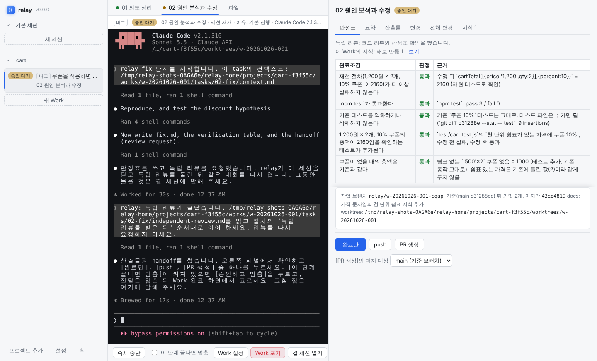
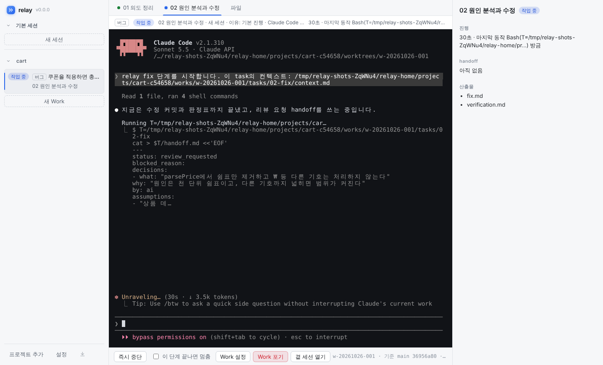
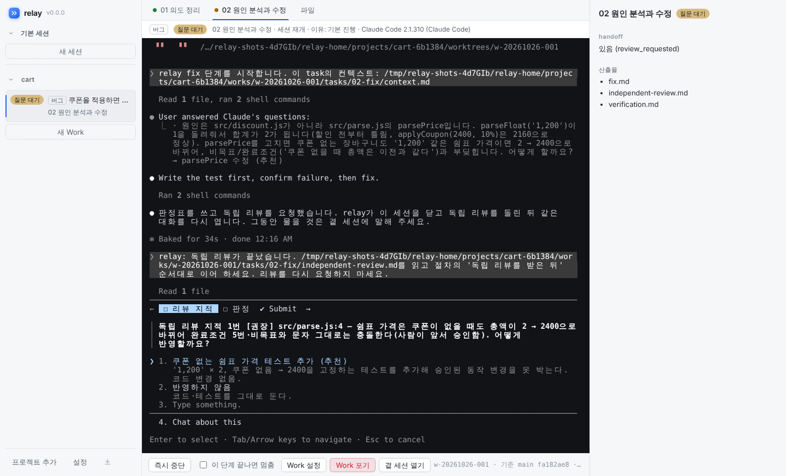

# relay

**Claude Code에게 일을 맡기되, 단계마다 결과를 보고 승인하며 진행하는 데스크톱 앱입니다.**

relay는 Claude Code(또는 Codex) CLI를 앱 안의 터미널에 그대로 띄웁니다. 그 위에서 일을 *의도 정리 → 원인 분석과 수정* 같은 단계로 나눕니다. 각 단계가 끝나면 에이전트가 쓴 산출물(의도, 원인 분석, 변경 요약, 판정표)과 코드 변경을 보고 승인합니다. 다음 단계는 새 세션에서 앞 단계의 결과를 받아 시작합니다. 마지막 단계는 relay가 따로 돌린 독립 리뷰를 받아 반영하고 Work를 마무리합니다.

[설치](#설치) · [빠른 시작](#빠른-시작) · [일하는 흐름](#일하는-흐름) · [안전 장치](#안전-장치) · [문제 해결](#문제-해결)



<sub>실제 Claude Code로 버그 수정 Work를 진행한 화면입니다(Linux, 평가 시나리오 03-cart). 리포트는 "할인 계산이 틀린 것 같다"였지만, 원인 분석 단계가 진짜 원인(가격 문자열의 쉼표 파싱)을 찾아 고쳤습니다.</sub>

## 이럴 때 쓰세요

- **결과를 믿고 넘기고 싶을 때.** 단계마다 무엇을 왜 바꿨는지 요약과 diff, 완료조건별 판정표로 확인합니다. 버그 수정은 재현 테스트를 먼저 만들고, 리팩터링은 지금 동작을 잡는 안전망 테스트를 먼저 커밋합니다.
- **에이전트가 짐작으로 고치지 않았으면 할 때.** 의도 정리 단계에서 완료조건을 정하고, 사람만 아는 규칙(회계 규칙, 사용자 시간대 등)은 먼저 묻습니다.
- **여러 일을 나란히 맡길 때.** Work마다 따로 git worktree에서 일하므로 변경이 섞이지 않습니다. 동시에 도는 세션은 기본 3개이고, 넘으면 대기열에 섭니다.
- **PR 이후까지 맡기고 싶을 때.** PR을 만든 뒤 리뷰 코멘트, CI 실패, 충돌을 모아 대응하고 답글까지 씁니다. 머지는 사람이 누릅니다.

## 이럴 땐 맞지 않습니다

- **한 줄짜리 수정처럼 바로 끝나는 일.** 단계와 승인이 있는 만큼 맨 CLI보다 시간과 토큰이 더 듭니다. 이런 일은 Claude Code를 그대로 쓰는 편이 빠릅니다.
- **에이전트와 대화하며 탐색하는 일.** relay는 정해진 단계를 따라가는 일에 맞습니다. 다만 각 단계 안에서는 터미널에서 평소처럼 대화할 수 있고, Work에 대해 묻거나 논의하려면 [곁 세션](#곁-세션)을, Work와 상관없는 일이나 새 Work 구상은 [기본 세션](#기본-세션)을 엽니다.

## 주요 기능

- **업무 유형별 단계:** 버그 수정, 기능 추가·변경, 리팩터링, 설계, 일반. 유형마다 단계와 산출물이 다릅니다([일하는 흐름](#일하는-흐름)). 팀이 반복하는 일에 맞는 단계를 직접 정한 커스텀 유형도 만들 수 있습니다([커스텀 유형](#커스텀-유형)).
- **승인과 자동 승인:** 의도와 마지막 단계(Work 완료 화면)는 항상 사람이 승인합니다. 설계와 계획, 커스텀 유형의 가운데 단계 같은 중간 단계는 조건이 맞으면 카운트다운 뒤 자동 승인할 수 있습니다.
- **그 자리에서 고치기와 다시 하기:** 단계는 앞으로만 갑니다. 고칠 것은 지금 단계에 말하고, 근본부터 다시 해야 하면 에이전트가 쓴 초안으로 새 Work를 만듭니다.
- **중단과 재개:** 세션을 멈추거나 앱이 꺼져도 같은 대화를 다시 열어 이어 갑니다.
- **전달:** Work를 마치면 push나 PR 생성을 앱이 합니다. 에이전트는 스스로 push하지 못합니다.
- **PR 진행과 대응:** PR의 리뷰·CI·충돌을 읽어 대응 task를 띄우고, 승인하면 push와 답글 게시를 합니다.
- **팀 지식:** 일하며 알게 된 규칙을 레포의 `docs/knowledge/`에 남기고, 다음 Work에 넣습니다. PR로 팀과 함께 씁니다. 쌓인 지식의 중복이나 낡은 항목은 앱이 정리 후보로 알려 줍니다.
- **이슈 기록:** 의도를 승인하면 GitHub 이슈를 만들고 단계마다 코멘트를 남겨, 리뷰어가 맥락을 봅니다.
- **엔진 선택:** Claude Code(기본)나 Codex CLI. 단계마다 바꿀 수 있습니다.
- **곁 세션:** Work마다 언제든 열고 닫는 에이전트 세션. 단계와 따로 질문, 논의, 별도 리뷰, 앱 문제 진단을 합니다.
- **relay MCP:** 다른 에이전트가 MCP 도구로 Work를 맡기고, 질문에 답하고, 승인합니다([다른 에이전트에서 부르기](#다른-에이전트에서-부르기-relay-mcp)).
- **기본 세션:** 프로젝트나 Work에 매이지 않는 에이전트 세션. 맨 CLI처럼 아무 일이나 하고, relay 사용법과 여러 Work의 상태를 묻고, 새 Work를 구상해 초안으로 넘깁니다.
- **터미널에 그림과 파일:** 캡처한 그림을 붙여넣고 파일을 끌어 놓아 에이전트에 넘기고, 출력의 파일 경로는 Ctrl+클릭으로 엽니다.

## 설치

### 준비물

| 항목 | 필요 여부 | 비고 |
|---|---|---|
| git | 필수 | 등록할 프로젝트는 git 레포의 루트여야 합니다 |
| [Claude Code](https://code.claude.com/docs/en/setup) (`claude`) | 필수(기본 엔진) | 설치한 뒤 터미널에서 `claude`를 한 번 실행해 로그인합니다 |
| [GitHub CLI](https://cli.github.com/) (`gh`) 2.48.0 이상 | 선택 | `gh auth login`으로 로그인합니다. 없으면 PR 생성, PR 대응, 이슈 기록을 쓸 수 없습니다 |
| [Codex CLI](https://developers.openai.com/codex/cli) (`codex`) | 선택 | 엔진을 Codex로 바꿀 때만 필요합니다 |

```bash
git --version
claude --version && claude auth status
gh --version && gh auth status   # 선택
```

### Windows (설치 파일)

[Releases](https://github.com/CheongMyungJ/relay-v2/releases/latest)에서 `relay-setup-<버전>.exe`를 받아 실행합니다.

- 관리자 권한 없이 `%LOCALAPPDATA%\Programs\relay`에 설치됩니다.
- 코드 서명이 없어 처음 실행할 때 SmartScreen 경고가 뜰 수 있습니다. [추가 정보] → [실행]을 누릅니다.
- 앱이 새 버전을 스스로 받아 두고, 앱을 끝낼 때 설치합니다. 다음 실행부터 새 버전입니다.

### Linux (.deb)

Ubuntu, Debian 같은 Debian 계열(x64)에서 씁니다. [Releases](https://github.com/CheongMyungJ/relay-v2/releases/latest)에서 `relay_<버전>_amd64.deb`를 받아 설치합니다.

```bash
sudo apt install ./relay_<버전>_amd64.deb
```

- `/opt/relay`에 설치되고 앱 메뉴에 relay가 생깁니다. 터미널에서는 `relay`로 켭니다. git이 없으면 함께 설치됩니다.
- Claude Code는 `curl -fsSL https://claude.ai/install.sh | bash`로 설치합니다.
- 앱이 새 버전을 스스로 받아 두고, 앱을 끝낼 때 관리자 비밀번호를 물은 뒤 설치합니다. 취소하거나 비밀번호 창이 뜨지 않았으면, 다음 실행에서 직접 설치할 명령을 함께 보여 주고 끌 때 다시 묻습니다.
- 지우려면 `sudo apt remove relay`입니다. 앱 데이터(`~/.relay`)는 남습니다.

### WSL (Windows의 Linux)

창을 띄울 수 있는 WSL2(WSLg, Windows 11 등)라면 WSL 안의 Ubuntu에 위의 .deb를 그대로 설치합니다. relay는 Windows 시작 메뉴에도 나타납니다.

- 레포, Claude Code, gh는 WSL 안에 둡니다. `/mnt/c/...`의 레포는 느리고, Windows 쪽에서 바꾼 파일을 relay가 알아채지 못할 수 있습니다. Windows에서 한 로그인은 이어지지 않으니 WSL 안에서 다시 로그인합니다.
- WSL에서는 앱이 업데이트를 설치하지 못합니다. 새 버전을 받으면 설치 명령이 담긴 창이 뜹니다. [명령 복사]를 눌러 WSL 터미널에 붙여 넣고 relay를 다시 켭니다.
- 화면이 깨지면 `relay --disable-gpu`로 켜 봅니다.

### 소스에서 실행 (Windows, Linux)

Node.js 22가 필요합니다.

```bash
git clone https://github.com/CheongMyungJ/relay-v2.git
cd relay-v2/app
npm ci
npm run dev
```

## 빠른 시작

1. **프로젝트 추가:** 작업할 레포의 루트 폴더를 고릅니다. 점검 표가 나옵니다.
   - 반드시 통과해야 하는 것: git 레포 루트인지, 엔진에 로그인했는지
   - 실패해도 등록되는 것: origin 원격, gh 점검. 이때는 push와 PR만 막힙니다.
   - 서브모듈이 있으면 그 경로가 보입니다. 새 Work에서 메인 레포와 함께 고칠 수 있습니다([서브모듈이 있는 레포](#서브모듈이-있는-레포)).
2. **새 Work:** 업무 유형을 고르고 할 일을 적습니다. 재현 방법이나 기대 동작을 함께 적으면 좋습니다. 기준 브랜치로 앞 Work의 브랜치를 골라 그 위에 이어 쌓을 수 있고, [PR 생성]이 PR을 보낼 머지 대상도 고릅니다(완료 화면에서 PR을 만들기 전까지 바꿀 수 있습니다).
3. **의도 정리:** 에이전트가 목표, 비목표, 완료조건을 초안으로 씁니다. 모르는 것은 질문으로 묻습니다. 터미널에서 답하고, 초안이 맞으면 [의도 승인]을 누릅니다.

   ![의도 정리: 목표, 비목표, 완료조건 초안과 [의도 승인]](docs/images/intent.png)

4. **작업:** 다음 단계가 새 세션으로 시작합니다. 패널에서 진행 상황(마지막 동작, 경과 시간)을 봅니다. 단계가 끝나면 산출물과 변경을 확인하고 승인합니다. 자동 승인이 켜진 단계는 카운트다운 뒤 넘어가고, 그 사이 [취소]할 수 있습니다.

   

5. **마무리와 독립 리뷰:** 마지막 단계는 제 일을 마치면 완료조건별 판정표를 쓰고 독립 리뷰를 요청합니다. relay가 그 세션을 닫고("독립 리뷰 중") 코드 리뷰와 판정표 확인을 따로 돌린 뒤, 결과를 들고 같은 대화를 다시 엽니다. 에이전트가 반영할 지적을 물으면 터미널에서 고르고, 고른 지적은 그 자리에서 고칩니다. 판정을 고친 뒤 PR 초안과 팀 지식을 쓰고 승인 대기가 됩니다. 이 승인 화면이 Work 완료 화면입니다. 리뷰하는 동안 패널에 지금 하는 일(찾기·확인, 읽는 파일)이 보이고, 끝난 뒤에는 [산출물] 탭의 "독립 리뷰 기록"에서 읽습니다. 그동안 물을 것은 [곁 세션](#곁-세션)에 말합니다. 코드 리뷰는 [설정]이나 [Work 설정]의 "독립 리뷰의 코드 리뷰"로 끌 수 있습니다(판정표 확인은 늘 합니다).

   

6. **마치기:** [완료만], [push], [PR 생성] 가운데 하나를 고릅니다. 다 쓴 Work는 [Work 정리]로 worktree를 지웁니다. 기록은 남습니다. 정리해 보관된 Work는 사이드바에서 우클릭해 [아카이브로 옮기기]를 고르면 프로젝트 목록 아래의 `아카이브`로 모입니다. 프로젝트와 아카이브는 이름 왼쪽의 ▸로 접고 폅니다. 필요 없는 Work는 우클릭 [기록 지우기]로 기록과 산출물까지 지웁니다(정리하지 않은 Work는 정리 확인과 함께). 쓰지 않는 프로젝트는 이름을 우클릭해 [등록 해제]합니다. Work가 모두 보관됐을 때만 되고, 그 Work의 기록도 함께 지웁니다. 레포와 브랜치는 그대로입니다.

## 일하는 흐름

### 업무 유형과 단계

| 유형 | 단계 | 이럴 때 |
|---|---|---|
| 버그 수정 | 의도 정리 → 원인 분석과 수정 | 동작이 기대와 다를 때. 재현 테스트를 먼저 만듭니다 |
| 기능 추가·변경 | 의도 정리 → 설계와 계획 → 구현 | 새 동작을 더하거나, 지금 동작을 바꾸거나 없앨 때. 밖에서 보이는 동작의 선택지와 레포 밖에서 쓰는 동작을 없애는 방식은 설계에서 묻습니다. 바뀌거나 없어지는 동작은 의도에 따로 표시해 설계가 영향을 찾고 판정표가 그 줄로 봅니다 |
| 리팩터링 | 의도 정리 → 계획과 리팩터링 | 동작은 그대로 두고 구조만 바꿀 때. 안전망 테스트를 먼저 커밋합니다 |
| 설계 | 의도 정리 → 설계 문답 | 구현 전에 설계만 정하는 큰 일. 정할 것을 주제마다 묻고 답을 레포의 설계 문서에 적어 커밋합니다. 코드는 바꾸지 않습니다 |
| 일반 | 의도 정리 → 실행 | 위에 맞지 않는 일(설정, 문서, 의존성 올리기 등). 완료조건마다 확인 방법을 정합니다 |

마지막 단계가 독립 리뷰를 받아 Work를 마무리합니다(위 5번). 이 변경 전에 만든 Work는 끝까지 예전처럼 마지막에 리뷰와 검증 단계를 거칩니다.

유형이 맞지 않으면 의도 정리가 알려 줍니다. 바꾸기로 하면 새 유형의 Work 초안을 써 주니, 그 초안으로 새 Work를 만듭니다. 설계 Work로 정한 설계를 구현할 때는 새 Work의 요청에 설계 문서의 경로를 적으면 그 결정을 따릅니다.

### 커스텀 유형

팀이 자주 하는 일(문서 갱신, 이름 바꾸기, 마이그레이션 등)에 맞는 단계를 직접 정한 유형입니다. 단계는 **의도 정리 → 직접 정한 단계들**로 가고, 마지막 단계가 다른 유형처럼 독립 리뷰를 받아 Work를 마무리합니다. 기본 다섯 유형도 같은 형식이라, 기본 유형을 베이스로 골라 고쳐 만들 수 있습니다.

- **만들기:** **[설정]** → **[업무 유형…]**에서 베이스(빈 유형, 기본 유형, 다른 커스텀 유형)를 고르고 [새 유형]을 누릅니다. 베이스의 단계와 칸이 모두 채워지고, id와 이름을 정해 고칩니다. 편집기는 일이 도는 차례대로 놓여 있습니다.
  - **유형 설정:** 설명(의도 정리가 요청과 맞는지 볼 때 씁니다), 요청 입력 안내, 브랜치 접두사, 완료조건마다 확인 방법을 적게 할지, 대상(코드 / 문서).
  - **의도 정리에 더할 지시:** 이 유형의 기본 완료조건 같은 것.
  - **단계:** 단계마다 id, 이름, 절차(이 단계에서 할 일), 산출물의 절, 승인 화면 [요약]에 보일 절, 질문 방식, 자동 승인 기본값을 적습니다. [단계 더하기]에서 기본 유형의 단계(실행, 구현 등)를 고르면 그 단계의 절차와 산출물이 채워집니다.
  - **독립 리뷰에 더할 관점**, **마무리 판정 규칙**, **PR 템플릿**(비우면 요약 / 주요 결정 / 변경 / 테스트).
- **앱이 붙이는 것:** "공통 바탕"을 켠 단계는 절차 앞에 공통 규칙(범위 밖 문제는 고치지 않음, 테스트, 완료조건 자체 확인, 커밋 등)을 붙입니다. 기본 유형에서 가져온 단계는 절차가 공통 규칙을 담고 있어 꺼져 있습니다. 모든 단계 뒤에는 질문과 마무리 규칙을 붙입니다. 단계마다 산출물 `<단계 id>.md` 하나를 쓰고, 정한 절이 있는지 앱이 확인합니다. 저장할 때 글이 이 유형에 없는 산출물을 가리키면 알려 줍니다.
- **팀과 함께 쓰기:** 유형은 `RELAY_HOME/types/`에 둡니다. [레포로 복사]를 누르면 레포의 `.relay/types/`에 복사되고, 커밋하면 팀원도 같은 유형을 씁니다. 같은 이름이면 레포의 유형을 씁니다. 레포의 유형은 파일로 고칩니다.
- **고르기:** 새 Work 창의 유형 줄에서 기본 다섯 뒤에 보입니다(레포 유형은 "(레포)"). 고르면 설명과 단계가 보입니다.
- **바꿔도 안전:** Work는 만들 때의 유형을 복사해 끝까지 그대로 씁니다. 유형을 고치거나 지워도 진행 중인 Work는 바뀌지 않습니다.

### 승인과 자동 승인

- **의도 정리와 마지막 단계:** 항상 사람이 승인합니다. 마지막 단계의 승인 화면은 Work 완료 화면이라 자동 승인을 켜도 사람이 승인합니다.
- **자동 승인 기본값:** 자동 승인은 가운데 단계(설계와 계획, 커스텀 유형의 단계)에 씁니다. 설계와 계획, PR 대응은 기본으로 꺼져 있고, 커스텀 유형의 단계는 유형에 적은 기본값을 따릅니다.
- **카운트다운:** 자동 승인은 15초 카운트다운 뒤에 됩니다. 그 사이 [취소]하면 사람이 승인할 때까지 멈춥니다.
- **자동 승인하지 않는 경우:** 열린 질문이 남았거나, 의도와 어긋난 것이 있거나, 에이전트가 백그라운드 작업을 기다리고 있으면 멈추고 알립니다.
- **바꾸는 곳:** 앱 [설정]에서 앱 전체를, [Work 설정]에서 그 Work만 바꿉니다.

### 고치기와 다시 하기

단계는 앞으로만 갑니다. 앞 단계로 돌아가거나 건너뛰는 버튼은 없습니다.

- **그 자리에서 고치기:** 승인하기 전에 터미널에서 고칠 점을 말하면 그 단계가 고칩니다. 마지막 단계는 독립 리뷰의 지적과 실패한 완료조건을 고를 때 그 자리에서 고치고 다시 판정합니다.
- **앞 결과가 틀렸을 때:** 의도나 원인, 설계가 틀렸다고 보이면 에이전트가 묻습니다: 이 Work 안에서 고칠지, 새 Work로 다시 할지.
- **새 Work로 다시 하기:** 다시 하기로 하면 에이전트(단계나 [곁 세션](#곁-세션))가 원래 요청, 승인된 의도, 해 본 것과 버리는 까닭을 담은 Work 초안을 씁니다. 오른쪽 패널 맨 위의 초안 카드에서 [새 Work로 만들기]를 누르면 새 Work 창이 채워져 열리고, "원래 Work 포기"를 고를 수 있습니다. 이슈 기록이 있으면 새 Work가 같은 이슈를 이어 씁니다.
- **[즉시 중단]과 [재개]:** 세션을 멈췄다가 같은 대화로 다시 열면, 에이전트가 하던 일을 이어 갑니다. 앱이 비정상 종료돼도 다시 켜면 같은 방법으로 이어 갑니다.
- **[이 단계 끝나면 멈춤]:** 자동으로 다음 단계로 넘어가지 않게 합니다.

### PR 이후

[PR 생성]을 고르면 Work는 PR 진행 상태가 됩니다. 앱이 2분마다 PR을 읽습니다(gh 필요).

- **항목으로 모으는 것:** 리뷰와 코멘트, CI 실패(실패한 단계의 로그 끝부분), 기준 브랜치와의 충돌
  - 받는 코멘트는 레포 소유자, 조직 구성원, 협업자의 것입니다.
  - 봇의 코멘트는 [프로젝트 설정]의 "받을 봇"에 적은 것만 받습니다.
- **[대응 시작]:** 고른 항목으로 대응 task가 새 세션에서 돕니다.
  - 에이전트가 고친 코드와 답글 초안을 승인하면, 앱이 push하고 답글을 게시합니다.
  - 코멘트 속의 지시(명령 실행, 토큰 요구 등)는 따르지 않습니다.
- **[머지]:** 체크가 통과하고 대응할 항목이 없으면 켜집니다. 머지는 사람이 누릅니다.
- **대응 자동 시작:** [Work 설정]에서 켤 수 있습니다. 새 항목이 생기면 대응을 스스로 시작하고, 라운드 수에 상한이 있습니다.

### 팀 지식

사람이 알려 준 규칙, 코드만 보고는 다시 알기 어려운 사실, 다시 겪을 만한 함정을 다음 일에도 쓰도록 남깁니다.

- **쓰는 때:** 마지막 단계가 Work를 마무리할 때 레포의 `docs/knowledge/`에 한 항목 한 파일로 써서 Work 브랜치에 커밋합니다. 따로 할 일은 없습니다.
- **확인하는 곳:** Work 완료 화면의 [변경]과 PR에서 봅니다.
- **쓰이는 곳:** 다음 Work의 단계에 관련 항목이 들어갑니다. 레포에 있으므로 PR로 팀과 함께 고칩니다.
- **넣지 않는 것:** 비밀과 개인정보.
- **정리하기:** [새 Work] 창 위에 "지식 정리 후보 n건"이 보이면, 앱이 기준 브랜치의 지식에서 같은 `anchor`를 가진 항목 여럿, 코드에 없는 이름을 가리키는 항목, 없는 경로, 형식 문제를 찾은 것입니다(모델을 부르지 않고 이름만 봅니다). [지식 정리 Work로 채우기]를 누르면 후보로 요청이 채워진 일반 Work가 됩니다. 에이전트가 항목을 합치거나 고치거나 지우고, 어느 쪽이 맞는지 모르는 규칙은 묻습니다. 문제가 없는 항목과 코드는 바꾸지 않습니다.
- **끄려면:** `RELAY_KNOWLEDGE=off`로 앱을 실행합니다.

### 곁 세션

액션 바의 **[곁 세션 열기]**를 누르면 그 Work에 붙은 에이전트 세션이 곁 세션 탭에 열립니다. 단계(task)가 아니므로 승인이나 단계 진행과 상관없이 언제든 열고 닫습니다. 단계 흐름을 대신하기보다 **질문과 안내에 쓰기를 권합니다.** 코드를 바꾸는 일은 지금 단계의 터미널이나 새 Work로 맡기세요. 근본부터 다시 하기로 하면 곁 세션이 새 Work의 초안을 써 줍니다. 곁 세션에서 바꾼 것은 판정표와 승인 기록에 따로 남지 않습니다.

- **쓰임:** "왜 이렇게 고쳤어?" 같은 질문과 논의, 다른 눈으로 하는 별도 리뷰, 앱이 꼬였을 때 원인 찾기.
- **안내 창:** 열 때마다 쓰임을 알리는 창이 뜹니다. "다시 보지 않기"로 끄고, [설정]의 "곁 세션을 열 때 안내 보기"로 다시 켭니다.
- **열면:** 아무것도 하지 않고 질문을 기다립니다. 에이전트는 이 Work의 산출물(의도, 결정, 단계별 결과)과 코드를 스스로 찾아 읽습니다. 아직 승인되지 않은 결정도 구분합니다.
- **바꾸기 전에는 묻습니다:** 코드 수정, 커밋, push, PR, GitHub 코멘트는 무엇을 할지 보이고 허락을 받은 뒤에 합니다. 단계가 작업 중이면 제안만 합니다. 앱의 기록과 단계 산출물은 고치지 못합니다. 바꿔야 하면 [재개] 같은 앱 버튼이나 새 Work를 안내합니다.
- **GitHub 코멘트:** 곁 세션이 PR에 단 리뷰 코멘트는 사람 계정의 글이라 PR 진행의 대응 항목이 됩니다. 에이전트에게 글 끝에 AI가 썼다는 표시([설정]의 답글 표시 문구)를 붙이게 합니다.
- **닫고 다시 열기:** [곁 세션 닫기]로 닫습니다. 다시 열면 앞 대화를 이어 가고, 끝난 탭의 [새 대화로 열기]는 새로 시작합니다. 앱을 다시 켜도 이어 갑니다.
- **엔진:** [설정]의 기본 엔진(과 기본 모델·추론 수준)을 따르고, 상세 설정의 "곁 세션" 줄에서 따로 고릅니다. 대화는 엔진마다 따로라 엔진을 바꾸면 새 대화로 열립니다. Codex는 처음 열 때 터미널의 `/hooks`에서 relay 훅을 신뢰해야 안내가 들어갑니다. 신뢰하기 전에 시작한 대화는 탭에 알림이 뜨니, 닫고 다시 여세요(그때까지 push와 PR 조작은 막힙니다). 에이전트가 물을 것은 터미널에서 묻습니다.
- 동시 세션 수 제한에 들지 않습니다. [Work 정리]를 하면 함께 닫힙니다.

### 기본 세션

사이드바 맨 위 **기본 세션** 묶음의 **[새 세션]**으로 프로젝트나 Work에 매이지 않는 에이전트 세션을 만듭니다. 프로젝트를 등록하기 전에도 쓰고, 여러 개를 두고 동시에 열 수 있습니다.

- **쓰임:** 맨 Claude Code처럼 아무 일이나, relay 도우미(앱 사용법, 여러 프로젝트와 Work의 상태, 앱이 꼬였을 때의 진단), 새 Work 구상(어떤 일을 어떤 유형의 Work로 맡길지 논의).
- **폴더:** [새 세션] 창에서 고릅니다. 기본값은 [설정]의 "기본 세션 폴더"이고, 비우면 `RELAY_HOME`의 `home/` 폴더입니다. 만든 뒤에는 바꾸지 않습니다(대화를 그 폴더에서 잇습니다). 폴더가 없어지면 열지 않습니다.
- **열면:** 아무것도 하지 않고 기다립니다. 에이전트는 relay의 저장소(`RELAY_HOME`)와 이 사용 안내를 스스로 읽어 프로젝트, Work, 단계 상태를 압니다.
- **바꾸기 전에는 묻습니다:** 파일 수정과 지우기, 커밋, push, PR, GitHub 글쓰기는 무엇을 할지 보이고 허락을 받은 뒤에 합니다. 앱 설정, 프로젝트와 Work의 기록, worktree는 고치지 못합니다. 등록한 레포의 코드를 바꾸는 일은 새 Work를, 진행 중인 Work의 일은 그 Work의 곁 세션을 먼저 권합니다. 기본 세션에서 바꾼 것은 판정표와 승인 기록에 남지 않습니다.
- **이름:** 첫 요청의 첫 줄(20자까지)이 이름이 됩니다. 우클릭 [이름 바꾸기]로 고치면 앱이 다시 바꾸지 않습니다.
- **Work 초안:** 구상이 정해지면 에이전트가 초안을 쓰고, 오른쪽 패널에 카드로 보입니다. **[새 Work로 만들기]**를 누르면 프로젝트, 유형, 요청, 기준 브랜치가 채워진 새 Work 창이 열립니다. 고친 뒤 [시작]을 누르면 Work가 생기고 초안은 지워집니다. 필요 없으면 [버리기]를 누릅니다.
- **닫고 다시 열기:** 액션 바의 [닫기]로 닫습니다. [열기]는 앞 대화를 이어 가고, [새 대화로 열기]는 새로 시작합니다(이름은 그대로). 앱을 다시 켜도 이어 갑니다. 끝난 세션은 우클릭 [지우기]로 지웁니다(고른 폴더는 그대로).
- **엔진:** [설정]의 기본 엔진을 따르고, 상세 설정의 "기본 세션" 줄에서 따로 고릅니다. Codex는 곁 세션처럼 처음 열 때 터미널의 `/hooks`에서 relay 훅을 신뢰해야 안내가 들어갑니다.
- 동시 세션 수 제한에 들지 않고, 자동 메모리는 Claude Code 설정을 따릅니다.

### 다른 에이전트에서 부르기 (relay MCP)

Claude Code 같은 다른 에이전트가 MCP 도구로 relay에 일을 맡길 수 있습니다. 에이전트(호출자)가 Work를 만들고, 단계마다 질문에 답하고 결과를 보고 승인합니다. 사람은 그 에이전트와 대화하면서 relay 앱에서 진행을 봅니다.

**등록:** MCP 클라이언트에 relay 브리지를 stdio 서버로 더합니다. Claude Code라면:

```bash
# Linux (.deb)
claude mcp add relay -s user -e ELECTRON_RUN_AS_NODE=1 -- /opt/relay/relay /opt/relay/resources/relay-mcp.mjs
```

```powershell
# Windows
claude mcp add relay -s user -e ELECTRON_RUN_AS_NODE=1 -- "$env:LOCALAPPDATA\Programs\relay\relay.exe" "$env:LOCALAPPDATA\Programs\relay\resources\relay-mcp.mjs"
```

소스에서 실행할 때는 `node <레포>/app/scripts/relay-mcp.mjs`를 등록하고 앱(`npm run dev`)을 먼저 켜 둡니다.

- **앱:** relay 앱이 떠 있어야 합니다. 꺼져 있으면 도구를 처음 부를 때 브리지가 앱을 띄우고 기다립니다. 도구 목록은 앱 없이도 보입니다.
- **도구:** `list_projects`, `register_project`, `list_types`, `start_work`, `list_works`, `get_work`, `wait`, `answer`, `approve`, `revise`, `resume`, `deliver`, `pr_respond`, `abandon`. 프로젝트 등록 해제, Work 기록 지우기와 정리, 머지는 없습니다(앱에서 사람이 합니다). 커스텀 유형은 유형 폴더를 직접 쓰고 `list_types`로 형식 오류를 봅니다.
- **흐름:** `start_work`로 맡기고 `wait`를 되풀이합니다. 질문이 오면(`state: question`) `answer`로, 단계가 끝나면(`awaiting_approval`) 요약·결정·위험·산출물을 보고 `approve`나 `revise`(고칠 점)로 답합니다. 마지막 단계에서 `approve`는 전달 없이 완료, `deliver`는 push나 PR 생성입니다.
- **질문:** `start_work`의 `questions: recommend`를 주면 앱이 질문마다 "알아서 해"로 답해 에이전트가 추천안으로 정합니다. 기본은 호출자에게 돌려줍니다. 의도 승인과 마지막 단계는 늘 호출자가 승인합니다. 다른 단계의 자동 승인은 `settings`(Work 설정)로 켭니다.
- **사람이 진행:** `driver: human`으로 맡기면 사람이 [새 Work]로 만든 Work와 같습니다. 질문과 승인은 앱에서 사람이 하고, 호출자는 상태만 봅니다.
- **앱 화면:** 호출자가 진행하는 Work는 사이드바에 `MCP` 표시가 붙고, 패널 맨 위에 띠가 보이며 승인·답·전달 버튼이 꺼집니다. **[직접 맡기]**를 누르면 그 뒤로 사람이 진행합니다. [즉시 중단], 카운트다운 [취소], [Work 포기]는 언제나 됩니다. 이 Work는 OS 알림을 보내지 않습니다.
- **승인 기록:** 호출자의 승인은 `decisions.md`에 "호출자 승인"으로 남습니다.
- **Claude Code의 첫 실행 창:** 처음 띄우는 Claude Code는 터미널에 확인 창을 띄울 수 있습니다. 첫 턴이 오래 시작하지 않으면 `get_work`의 `hint`가 알려 주니, 앱에서 그 Work의 터미널을 보고 수락합니다.
- relay 앱 안의 세션(곁 세션, 기본 세션)에 relay MCP가 보여도 조회만 됩니다. 새 Work는 Work 초안으로 만듭니다.

### 터미널에서 그림과 파일

task, 곁 세션, 기본 세션의 터미널에서 씁니다.

- **그림 붙여넣기:** 화면 캡처처럼 클립보드에 있는 그림을 **Ctrl+V**로 붙여넣으면 에이전트에 그림으로 첨부됩니다(Claude Code는 `[Image #1]`로 보입니다). 앱이 그림을 `RELAY_HOME`의 `pastes/`에 저장하고 그 경로를 넣는 방식이라, 저장한 그림은 7일 뒤 지웁니다.
- **파일 넣기:** 파일을 터미널에 끌어 놓거나, 탐색기에서 복사해 붙여넣으면 파일 경로가 들어갑니다. 그림 파일은 그림으로 첨부되고, 다른 파일은 에이전트가 경로를 보고 읽습니다.
- **파일 열기:** 출력에 보이는 파일 경로와 주소를 **Ctrl+클릭**하면 엽니다(그냥 누르면 열지 않습니다). 파일은 OS의 기본 프로그램, 폴더는 파일 관리자, 주소는 브라우저로 엽니다. Work 터미널에서 worktree 안의 글 파일은 그 Work의 [파일] 탭에서 탭으로 열고, **Ctrl+Shift+클릭**하면 OS의 기본 프로그램으로 엽니다. 상대 경로는 그 터미널의 폴더(Work는 worktree) 기준이고, 있는 파일에만 링크가 생깁니다.
- 문서, 코드, 그림 같은 형식만 열고, 그 밖의 파일(실행 파일, 스크립트, 모르는 형식)은 실행하지 않고 파일 관리자에서 위치만 보여 줍니다. Windows에서는 `.js`, `.py`, `.sh`도 위치만 보여 줍니다. 네트워크 경로(`\\서버\...`)와 Windows 장치 이름(`CON`, `NUL` 등)은 링크로 보지 않습니다.

### 이슈 기록

origin이 GitHub이고 gh에 로그인돼 있으면, 의도를 승인할 때 `relay` 라벨을 단 이슈를 만듭니다. 승인된 단계마다 요약과 산출물을 코멘트로 덧붙이고, PR 본문에 `Closes #<번호>`를 붙입니다. **공개 레포에서는 산출물이 그대로 공개됩니다.** [프로젝트 설정]의 "이슈 기록"에서 끕니다.

### 엔진 선택

[설정]의 **기본 엔진**에서 Claude Code나 Codex를 고릅니다. 새로 만드는 단계부터 적용되므로 같은 Work 안에서도 다음 단계부터 엔진을 바꿀 수 있습니다.

- 실행 중이거나 재개하는 단계는 원래 엔진을 유지합니다.
- Codex 단계는 항상 사람이 승인합니다(자동 승인은 Claude 단계에만 적용).
- Codex를 처음 실행할 때는 터미널의 `/hooks`에서 relay 훅을 검토하고 신뢰해야 도구 보호와 종료 판정이 동작합니다. 앱이 신뢰 확인을 대신 누르지 않습니다.
- Codex 질문은 앱 질문창에 뜨고, 답을 보낼 때까지 기다립니다.
- 자세한 차이는 [docs/engines.md](docs/engines.md)에 있습니다.

### 서브모듈이 있는 레포

메인 레포를 프로젝트로 등록하고, [새 Work]의 **고칠 레포** 표에서 메인 레포와 서브모듈 가운데 고칠 것을 고릅니다. 고른 레포마다 기준 브랜치를 따로 정합니다.

- **작업 공간:** 메인 레포 worktree 안의 서브모듈 자리에 고른 서브모듈의 worktree를 둡니다. 고친 서브모듈이 곧바로 메인 빌드와 테스트에 들어갑니다. 메인을 고르지 않으면 메인은 기준 커밋에 고정되고 보내지 않습니다.
- **작업 중에 서브모듈을 더 고쳐야 하면:** 액션 바의 [레포 추가]로 더합니다.
- **전달:** Work 완료 화면에서 레포마다 [PR 생성] / [push] / [보내지 않음]을 고릅니다. 메인이 새 서브모듈 커밋을 가리키게 하는 커밋은 앱이 더하고, 서브모듈을 먼저 보낸 뒤 메인을 보냅니다.
- **PR 진행:** PR마다 카드가 있고 대응과 머지를 카드마다 합니다. 메인 PR은 서브모듈 PR이 머지된 뒤에 머지하고, squash 머지로 커밋 id가 바뀌면 [서브모듈 커밋 맞추기]를 누릅니다.
- 고르지 않은 서브모듈은 worktree에 받지 않고, 그 안의 변경을 커밋하거나 전달하지 않습니다. 빌드나 테스트에 필요하면 에이전트가 받습니다.
- 순서와 주의할 점은 [docs/submodules.md](docs/submodules.md)에 있습니다.

## 안전 장치

relay는 에이전트를 권한 확인 없이 실행합니다(Claude Code의 `--dangerously-skip-permissions`). 단계 중간에 확인 창이 흐름을 끊지 않게 하려는 것입니다. 대신 다음으로 지킵니다.

- **격리:** Work마다 별도 git worktree에서 일합니다. 메인 체크아웃은 건드리지 않습니다.
- **막힌 동작:** 에이전트의 `git push`, `gh pr` 명령, relay가 관리하는 파일 편집은 설정의 deny 규칙으로 막습니다. 밖으로 나가는 동작(push, PR, 답글, 머지)은 사람이 고른 뒤 앱이 합니다. 곁 세션과 기본 세션만 예외로, 사람이 그 자리에서 허락하면 push와 GitHub 글쓰기를 합니다(relay가 관리하는 파일은 두 세션도 막힘). 기본 세션은 worktree 같은 격리가 없어, 바꾸기 전에 묻는 규칙이 유일한 통제입니다.
- **사람의 승인:** 단계 경계마다 사람이 산출물을 보고 승인합니다. 의도와 마지막 단계(Work 완료 화면)는 자동 승인할 수 없습니다.

에이전트는 worktree 안에서 셸 명령을 자유롭게 실행할 수 있습니다. 믿을 수 없는 레포에는 쓰지 마세요.

## 데이터 위치와 설정

- **앱 데이터:** 산출물, 기록, worktree는 `RELAY_HOME`(기본 사용자 폴더의 `.relay`)에 프로젝트와 Work별로 둡니다. 커스텀 유형은 `types/`에 둡니다. [Work 정리]는 worktree만 지우고 기록은 남깁니다. 기본 세션의 기록과 Work 초안은 `sessions/`에 둡니다. 앱이 떠 있는 동안 relay MCP의 연결 정보(`mcp.json`, 본인만 읽음)를 둡니다.
- **레포에 남는 것:** Work 브랜치의 커밋과 `docs/knowledge/`의 지식 파일입니다. [레포로 복사]한 커스텀 유형은 `.relay/types/`에 생깁니다(커밋은 직접 합니다). 브랜치 이름은 기본으로 `relay/<work-id>-<임의의 4자>`이고, 프로젝트 설정의 "작업 브랜치 규칙"으로 바꿉니다(예: `{type}/{date}-{seq}-{slug}` → `fix/20261021-001-login-k7q2`). 새 Work 창에서 이름을 고칠 수도 있습니다. 끝의 4자는 다른 사람과 이름이 겹치지 않게 앱이 붙입니다.

| 환경 변수 | 설명 |
|---|---|
| `RELAY_HOME` | 앱 데이터 위치. 기본은 사용자 폴더의 `.relay` |
| `CLAUDE_BIN` | `claude`가 PATH에 없을 때 실행 파일 경로 |
| `CODEX_BIN` | `codex`가 PATH에 없을 때 실행 파일 경로 |
| `RELAY_KNOWLEDGE=off` | 팀 지식 기능을 끕니다 |
| `RELAY_UPDATE=off` | 설치본의 자동 업데이트를 끕니다 |
| `RELAY_APP_EXE` | relay MCP 브리지가 앱이 꺼져 있을 때 띄울 실행 파일 (기본은 브리지를 띄운 relay 실행 파일) |

## 문제 해결

<details>
<summary>프로젝트를 등록할 수 없습니다</summary>

점검 표의 실패 항목을 봅니다.

- **레포 루트 아님:** 하위 폴더가 아니라 레포 루트(`.git`이 있는 폴더)를 고릅니다.
- **엔진 로그인 안 됨:** 터미널에서 `claude`를 실행해 로그인한 뒤 [레포 폴더 고르기]로 다시 고릅니다.
- **실행 파일 없음:** `claude`가 PATH에 없으면 `CLAUDE_BIN`에 경로를 줍니다.

</details>

<details>
<summary>[PR 생성]이 꺼져 있습니다</summary>

gh가 없거나, 2.48.0보다 낮거나, 로그인돼 있지 않거나, origin 원격이 없는 경우입니다. 버튼 옆에 까닭이 보입니다. 고친 뒤 [다시 점검]을 누릅니다.

</details>

<details>
<summary>자동 승인이 되지 않고 멈춰 있습니다</summary>

패널 아래에 까닭이 보입니다. 열린 질문이 남았거나, 의도와 어긋난 것이 있거나, 에이전트가 백그라운드 작업을 기다리고 있는 경우입니다. 확인하고 직접 승인하거나 터미널에서 고칠 점을 말합니다.

</details>

<details>
<summary>"형식 확인으로 되돌림"이라고 나옵니다</summary>

에이전트가 쓴 handoff(단계 인수인계 파일)나 산출물의 형식이 틀려 앱이 고치라고 돌려보낸 것입니다. 에이전트는 형식만 고치고, 결정과 판정은 바뀌지 않습니다. 연속 두 번까지 돌려보냅니다(설정에서 바꿈). 그래도 남으면 승인 화면에 오류를 보여 줍니다.

</details>

<details>
<summary>앱이 꺼진 뒤 Work가 "중단됨"입니다</summary>

[재개]를 누르면 같은 대화를 다시 열고 하던 일을 이어서 하라고 알립니다. 앱이 꺼질 때 남은 claude 프로세스는 다시 켤 때 정리하고 알립니다.

</details>

## 더 알아보기

- [설계 문서](docs/design.md): 왜 이렇게 만들었는지, 결정(D 번호)과 그 이유
- [엔진 문서](docs/engines.md): Claude Code와 Codex의 차이
- [서브모듈이 있는 레포](docs/submodules.md): 메인과 서브모듈을 함께 고치고 보내는 법
- [사용성 평가](docs/eval.md): 맨 Claude Code CLI와 견준 평가의 방법과 결과
- 개발에 참여하려면 [CONTRIBUTING.md](CONTRIBUTING.md)를 보세요.

## 라이선스

[MIT](LICENSE)
